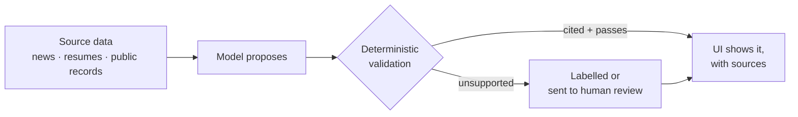

<!--
  Optional banner: make two 1280x320 PNGs (light + dark), commit them to assets/, then uncomment.
<picture>
  <source media="(prefers-color-scheme: dark)" srcset="assets/banner-dark.png">
  
</picture>
-->

# Nicole Rodriguez

**Full-stack engineer. I build AI products that show their evidence.**
TypeScript · React · Next.js · Python · FastAPI · PostgreSQL · Claude API · New York

> [!NOTE]
> **Open to full-stack and applied-AI engineering roles** in NYC or remote.
> [nicolerodriguez.dev](https://nicolerodriguez.dev) · [LinkedIn](https://www.linkedin.com/in/nicolerodriguezz/) · [Email](mailto:nicolerodriguezcab@gmail.com)

I came to engineering from media, so I start with the reader: what do they need to trust, what do they need to do next, and where should the product say "I don't know"? Every AI feature I ship follows the same pattern:

## Selected work

<!-- When the GIFs exist, add one under each project heading:
      -->

### [Vantage](https://github.com/Nicolercc/vantage) · [live demo](https://conflict-analysis-vantage.vercel.app)
Conflict briefs from live international news. Next.js · TypeScript · RAG · Claude
→ Claude keeps only the claims it can tie to a retrieved source. Anything else is labelled as background knowledge.

### [Ruvia](https://github.com/Nicolercc/ruvia) · [live demo](https://ruvia.vercel.app)
Evidence-first recruiting review. FastAPI · React · TypeScript · Claude
→ The LLM analyzes, deterministic code scores, and a human decides. Every supported claim cites resume evidence.

### [Sano](https://github.com/Nicolercc/Sano) · [live demo](https://sano-nine.vercel.app)
Plain-language context for NYC restaurant inspection grades. Next.js · Python · NYC open data
→ Official data stays visually separate from derived signals. Includes a methodology page and repeatable accessibility checks.

### [Code4Kidz](https://github.com/Nicolercc/code4kidz) · [live demo](https://code4kidz-six.vercel.app)
HTML/CSS course for kids 7–10 with a live editor. React · Vite · Zustand
→ I audited an AI-built prototype and re-engineered it: fixed 29 of 123 answer checks, got to 0 axe violations, and enforced both in CI.

### [Sala](https://github.com/Nicolercc/Sala) · [live demo](https://sala-privacy-board.netlify.app)
Privacy-first clinic check-in. React · TypeScript
→ Data reaches the waiting-room board only through an allow-list projection. Tests fail if a sensitive field leaks.

### [jt](https://github.com/Nicolercc/jt)
Local-first job tracker CLI. Python · SQLite · event sourcing
→ Uses an append-only event log. The LLM can propose changes but never commit them, and evals track its classification accuracy.

<b>More projects</b>

- [Impactify](https://github.com/Nicolercc/impactify2.0): civic news to action. Next.js · Supabase · Claude
- [TripCanvas](https://github.com/Nicolercc/tripcanvas): travel planner that checks whether each day is realistic. Client-side state machine with enforced invariants
- [EGCS](https://github.com/Nicolercc/egcs): production site for a NYC client

## Open source

- **merged** · [carbonshift #1](https://github.com/PixelAndFlow/carbonshift/pull/1): map integration
- **in review** · [oxc #27276](https://github.com/oxc-project/oxc/pull/27276): linter rule `jest/padding-around-before-all-blocks`
- **in review** · [excalidraw #12147](https://github.com/excalidraw/excalidraw/pull/12147): templates prototype

## How I build with AI

- I build with **Claude Code**, and **Codex** independently reviews every significant change.
- Model output is untrusted input: it's validated, cited and tested before the UI shows it.
- Every repo's README covers its decisions and its limits, not just its features.
