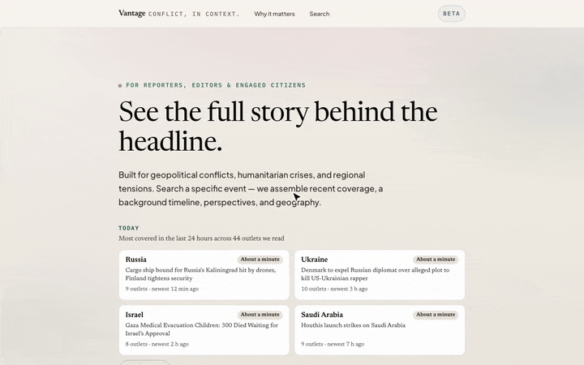
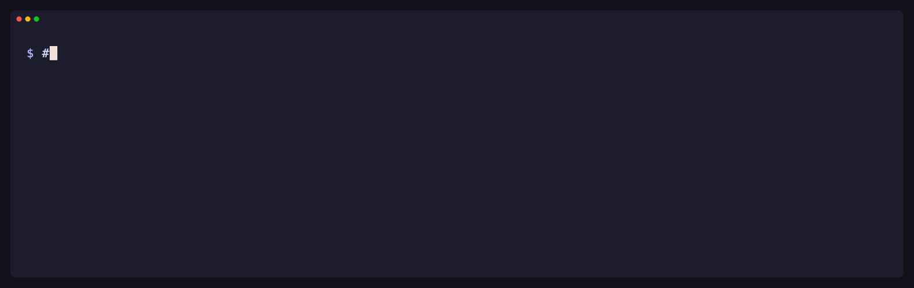
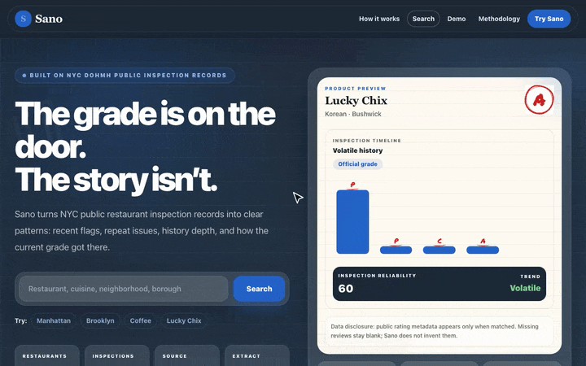
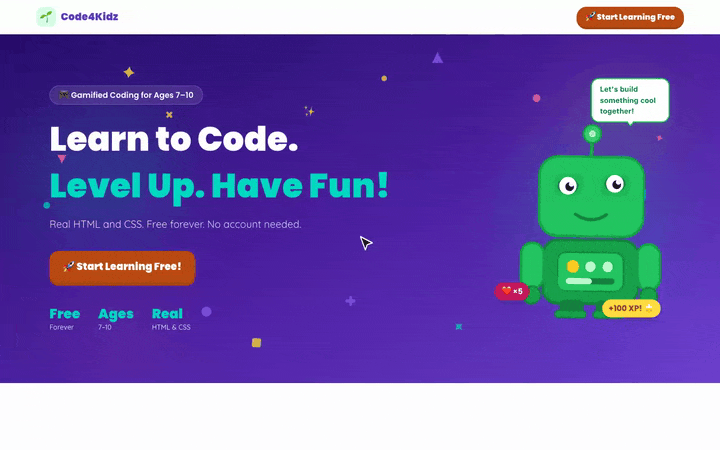

<a href="https://nicolerodriguez.dev">
  <picture>
    <source media="(prefers-color-scheme: dark)" srcset="assets/hero-dark.svg">
    
  </picture>
</a>

  
  
  
  

I came to engineering from media, where the job is knowing what you can stand behind. I build software the same way. A reader should always be able to see **where a claim came from**, **what the product isn't sure of**, and **who made the call**. When a model is involved, it proposes. Deterministic code checks. Anything the code can't prove gets labelled or goes to a person.

## Proof, not promises

Every number below links to the README section or test suite that backs it.

| Project | What the tests and evals show | Receipt |
|---|---|---|
| **Vantage** | Deterministic quote checks alone stop **8 of 11** unsupported claims on a hand-labelled set, before a second model reviews what's left. **391 tests**, plus axe browser tests at phone and desktop width in CI. | [decisions](https://github.com/Nicolercc/vantage#key-engineering-decisions) · [tests](https://github.com/Nicolercc/vantage#testing-and-quality) |
| **jt** | **125 tests** on Python 3.11 and 3.12 with mypy. The classifier eval reports precision and recall with 95% intervals and tracks wrong terminal-state commits (target: zero). | [invariants](https://github.com/Nicolercc/jt#the-five-invariants) · [eval](https://github.com/Nicolercc/jt#measuring-the-classifier) |
| **Code4Kidz** | Audited an AI-built prototype: answer checks failed **29 of 123** cases, and every screen had **3–6** axe violations. Now **0**, enforced in CI. | [audit](https://github.com/Nicolercc/code4kidz#how-this-was-built) |
| **Sano** | Rules, not a model: every score can be reproduced from a [published formula](https://sano-nine.vercel.app/methodology), and a seed-integrity test fails if the app and the scorer ever disagree. | [decisions](https://github.com/Nicolercc/Sano#key-engineering-decisions) · [tests](https://github.com/Nicolercc/Sano#testing-and-quality) |

## Selected work

### AI with a trust boundary

#### [Vantage](https://github.com/Nicolercc/vantage): conflict briefs that quote their sources
 

Type a conflict, get a brief built from live international reporting in about a minute.
**The decision:** provenance belongs to code, not the model. Claude refers to sources only by ID, and the publisher, URL and date come from retrieval. Anything without a source is labelled as model background.
React · TypeScript · Express · Postgres · OpenAPI → Zod · RAG · Claude

#### [jt](https://github.com/Nicolercc/jt): a job tracker where the LLM can't write to the database

A local-first CLI built on an append-only event log.
**The decision:** email is the reconciliation path, not the write path. The model proposes events, and only legal state transitions get committed, for the model and for me alike.
Python · SQLite · event sourcing · Gmail API · Claude · macOS menu bar

### Products where trust is the feature

#### [Sano](https://github.com/Nicolercc/Sano): the story behind a NYC restaurant grade
 

**The decision:** official city records and consumer review data never share a field or a panel. The API returns `null` for anything without a source behind it.
Next.js · TypeScript · Python · NYC Open Data · Supabase (optional, falls back to a committed seed)

#### [Code4Kidz](https://github.com/Nicolercc/code4kidz): a real HTML course for kids 7–10
 

**The decision:** treat an AI-built prototype as a draft, not a product. I audited it, then re-engineered it one concern per commit, each with the evidence it was tested on.
React · Vite · TypeScript · Zustand · CodeMirror · Playwright + axe

<b>More projects</b>

 

| Project | What it is |
|---|---|
| [Ruvia](https://github.com/Nicolercc/ruvia) · [demo](https://ruvia.vercel.app) | Recruiting review: Claude finds resume evidence, Python computes the score, a recruiter decides. 61 tests. |
| [Sala](https://github.com/Nicolercc/Sala) · [demo](https://sala-privacy-board.netlify.app) | Clinic check-in where the waiting-room board gets data only through an allow-list projection. 11 privacy rules, each enforced by a test. |
| [writelater](https://github.com/Nicolercc/writelater) | Capture thoughts on the go, then know where to write them in your paper planner. |
| [Impactify](https://github.com/Nicolercc/impactify2.0) · [demo](https://impactify2-0.vercel.app) | Civic news → context → action. Next.js, Supabase, Claude. |
| [TripCanvas](https://github.com/Nicolercc/tripcanvas) | Travel planner that tells you whether each day is realistic. Client-side state machine with enforced invariants. |
| [NYC nuclear simulator](https://github.com/Nicolercc/nuclear-shelter-app) · [demo](https://nuclear-escape.vercel.app) | Educational emergency simulator: blast zones, shelters, evacuation routes. |
| [Morning Briefing Agent](https://github.com/Nicolercc/Morning-Briefing-Agent) | Local-first agent that turns Gmail, Calendar and Slack into one Slack digest. |
| [Parla](https://github.com/Nicolercc/Parla) · [demo](https://parla-rho.vercel.app) | Mobile-first Spanish-learning prototype with a unit path, quizzes, hearts and streaks. |
| [EGCS](https://github.com/Nicolercc/egcs) | Production marketing site for a NYC client. |

## Recently shipped

My latest merged pull request in each repo. A [GitHub Action](.github/workflows/shipped.yml) refreshes this table every day.

<!-- shipped:start -->
| Merged | Repo | Change |
|---|---|---|
| 2026-11-21 | [jt](https://github.com/Nicolercc/jt) | [Never record an alert as sent when macOS didn't deliver it (T1)](https://github.com/Nicolercc/jt/pull/59) |
| 2026-11-15 | [vantage](https://github.com/Nicolercc/vantage) | [Browser tests in CI: accessibility, layout and touch at phone and desktop size](https://github.com/Nicolercc/vantage/pull/29) |
| 2026-11-13 | [writelater](https://github.com/Nicolercc/writelater) | [Split ReviewScreen into a controller hook and per-view components](https://github.com/Nicolercc/writelater/pull/14) |
| 2026-11-12 | [code4kidz](https://github.com/Nicolercc/code4kidz) | [docs: add verified live demo walkthrough](https://github.com/Nicolercc/code4kidz/pull/3) |
| 2026-11-11 | [Sano](https://github.com/Nicolercc/Sano) | [docs: Lucky Chix walkthrough with the C-to-A timeline](https://github.com/Nicolercc/Sano/pull/4) |
| 2026-11-11 | [nuclear-shelter-app](https://github.com/Nicolercc/nuclear-shelter-app) | [Fix CI and add tests for blast-zone and distance math](https://github.com/Nicolercc/nuclear-shelter-app/pull/1) |
<!-- shipped:end -->

## Open source

| Status | Project | Contribution |
|---|---|---|
|  | carbonshift | [Map integration](https://github.com/PixelAndFlow/carbonshift/pull/1) |
|  | oxc (Rust JS toolchain) | [Linter rule `jest/padding-around-before-all-blocks`](https://github.com/oxc-project/oxc/pull/27276) |
|  | Excalidraw | [Templates prototype](https://github.com/excalidraw/excalidraw/pull/12147) |

## How I build with AI

- **Claude Code builds, and Codex independently reviews** every significant change.
- **Model output is untrusted input.** It's validated, cited and tested before the UI shows it.
- **Small pull requests, CI on every repo.** Tests run against fake models, so CI needs no API keys and costs nothing.
- **READMEs cover decisions, tradeoffs and limits**, not just features. Every project above documents what it does not do.

## This profile is code, too

- The banner is an animated SVG drawn by [`scripts/hero.mjs`](scripts/hero.mjs), in light and dark versions.
- Every demo GIF is recorded by a [Playwright script](demos/scenes.mjs) against the live site, with captions naming the decision on screen. A [manual workflow](.github/workflows/demos.yml) re-records them and opens a pull request.
- The status badges are live: demos are pinged, CI is real, and open-source PR states update themselves.

New York · [nicolerodriguez.dev](https://nicolerodriguez.dev) · [LinkedIn](https://www.linkedin.com/in/nicolerodriguezz/) · [nicolerodriguezcab@gmail.com](mailto:nicolerodriguezcab@gmail.com)
